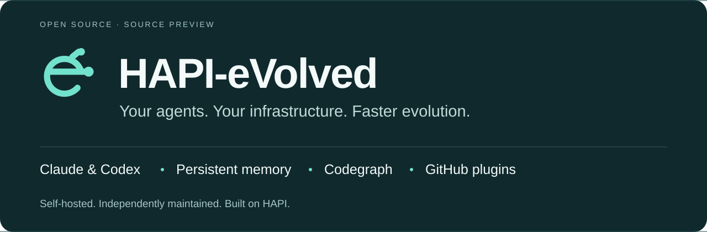
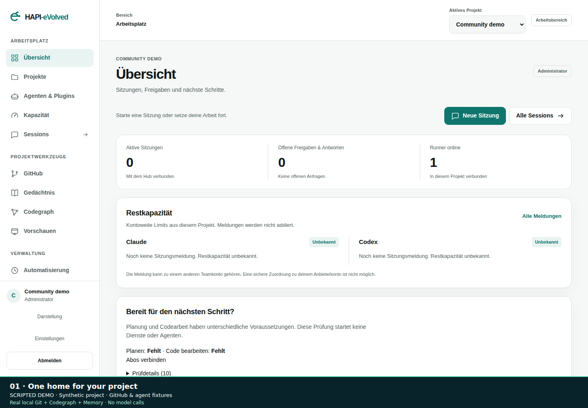

<p align="center">
  
</p>

# HAPI-eVolved

**Your agents. Your infrastructure. Faster evolution.**

A self-hosted workspace for coding agents, built for the way you actually work:
connect Claude or Codex in your browser, give each project a home, and keep your
agents, credentials, memory and code intelligence together.

HAPI-eVolved is an **independent fork of [HAPI](https://github.com/tiann/hapi)**.
Our goal is to turn useful ideas into working features quickly: shorter feedback
loops, flexible integrations and practical improvements across the whole
workspace. We build on HAPI's local-first foundation, preserve its history and
credits, and follow our own roadmap.

[Get started](docs/evolved/QUICKSTART.md) ·
[Explore the features](docs/evolved/USER_GUIDE.md) ·
[Join the pilot](docs/evolved/PILOT.md) ·
[Community](COMMUNITY.md) ·
[Roadmap](ROADMAP.md) ·
[Suggest a feature](https://github.com/BGGBTAC/hapi-evolved/issues/new?template=feature-request.yml) ·
[Contribute](CONTRIBUTING.md)

**[Source preview releases](https://github.com/BGGBTAC/hapi-evolved/releases)** · Linux + Docker Compose · Desktop & mobile PWA ·
Claude Code & Codex · AGPL-3.0-only



[Watch the 76-second walkthrough](assets/community/walkthrough.webm) ·
[Mobile view](assets/community/mobile.png) ·
[Codegraph review](assets/community/codegraph.png) ·
[Demo scope and reproduction](assets/community/README.md)

The recording shows the real interface with a synthetic project and controlled
GitHub/provider fixtures. It makes no model calls. Some interface labels are
currently German; the setup and pilot guides are available in English.

## What makes it Evolved

| You want to… | HAPI-eVolved adds… |
| --- | --- |
| Connect your coding subscriptions | Native Claude/Codex browser sign-in, persistent private credentials and automatically managed project runners |
| Choose models as providers evolve | Native model catalogs, refresh, provider defaults and a custom model ID |
| Start a project without setup chores | An automatic folder for every project; new sessions use it automatically, with optional manual folder selection when creating the project |
| Specialize a development project | Odoo 19/20, iOS and Android modules, plus declarative modules from GitHub plugins, with versioned handbooks, toolchain checks, repository inspection and prepared agent tasks |
| Work with GitHub directly | Clone and update project repositories, explicitly start sessions in a checkout, and inspect local changes without starting a model |
| Review changes in context | Repository diffs, Codegraph impact hints and a review specialist in the same checkout |
| Know what is ready | Project diagnostics for the working folder, live runner RPC, native login, repositories, Codegraph and memory |
| Reuse your best agents | Global specialist templates that run within each project's permissions and profile |
| Share MCP tools across agents | A project MCP shop with Context7, custom HTTPS servers, encrypted credentials, tool grants and recent-call diagnostics |
| Add your own extensions | Public GitHub plugins for agent templates, skills and color profiles, with preview and pinned revisions |
| Keep useful context | Source-linked proposals from stored messages and files, persistent local search, and an optional Graphiti/Neo4j knowledge graph |
| Understand a codebase | Codegraph symbol search, callers, impact analysis and affected-test exploration |
| Control access and credentials | Passkeys, team/project roles, an encrypted local vault and revocable runner access |
| Stay productive on any screen | Responsive desktop and mobile layouts, light/dark/OLED modes and selectable color profiles |
| See where your subscription stands | Native usage reports with reset times and explicit stale or unavailable states |
| Keep work moving | Searchable history, durable attachments, saved prompts, project automation and private previews |

The fork is about **shipping useful capabilities faster while keeping changes
reviewable and behavior testable**. Feature proposals, focused patches and
real-world feedback are welcome. The [roadmap](ROADMAP.md) explains what comes next.

## Start your workspace

The supported preview is a **fresh Linux installation using Docker Compose**,
built from this repository. Use **Bun 1.3.14** and plan for approximately
**12 GiB RAM** for the stack and one runner. These instructions target
`v0.1.0-preview.3`; verify that it has a published source release and checksums
before using the tag below. Development `main` is not itself a published release.

```sh
git clone --branch v0.1.0-preview.3 --depth 1 https://github.com/BGGBTAC/hapi-evolved.git
cd hapi-evolved
bun install --frozen-lockfile
```

The [release downloads](https://github.com/BGGBTAC/hapi-evolved/releases)
include the source archive, manifest and checksums for each published revision.

Continue with the [English quick start](docs/evolved/QUICKSTART.md) to initialize
private state, build the services, configure HTTPS and create your first account.
Choose the final HTTPS hostname before registering a passkey. For a local test,
`http://localhost:3006` is supported.

Browser provisioning requires the [local control service](docs/evolved/HOST_CONTROL.md),
installed by the operator as described in the quick start. Once signed in, open
**Connect subscriptions / Abos verbinden**, choose your project and follow the
provider's browser sign-in. HAPI-eVolved prepares the project runner when needed.
You can then start a session or a specialist agent.

For a source checkout or archive containing the installation assistant,
`bun deploy/evolved/install.ts check` performs a read-only prerequisites check.
The assistant starts a separate core stack; managed browser login additionally
needs the [English host-control setup](docs/evolved/HOST_CONTROL.md). It does not
upgrade an existing installation or configure privileged host services.

This repository supplies the Evolved stack. Upstream `@twsxtd/hapi` packages and
upstream hosted services install or operate upstream HAPI, not this fork.
There are currently no official Evolved npm packages, prebuilt images or native
app-store releases. A source preview is not a production-readiness guarantee.

## Know what you are running

- **Models:** the list comes from the native provider client. It may be cached or
  depend on the client version; it does not guarantee every newly announced model
  or your account's entitlement. Provider defaults and custom model IDs remain
  available. See [provider login and models](docs/evolved/PROVIDER_LOGIN.md).
- **Plugins:** this preview accepts declarative extensions from public GitHub
  repositories. Plugins contribute instructions and themes, not arbitrary
  executable code. See [the plugin format](docs/evolved/EXTENSIONS.md).
- **Memory:** local memory works independently. Optional cloud extraction starts
  paused and requires provider configuration and a project budget. The knowledge
  graph and Codegraph serve different purposes.
- **Development modes:** bundled handbooks work without the knowledge graph.
  The optional development runner adds local toolchains; native iOS builds still
  require macOS or a configured cloud workflow. See [development modes](docs/evolved/DEVELOPMENT_MODES.md).
- **Credentials:** the vault stores integration credentials and exposes constrained
  actions. It is not a browser password-autofill manager. Provider subscriptions
  and API keys are separate authentication methods.
- **Scope:** Linux, Web/PWA, Claude Code and Codex are the validated preview path.
  Inherited native apps and other adapters remain available to contributors, with
  their support status documented separately.

[Validation](docs/evolved/VALIDATION.md) records actual checks and their limits.
Back up persistent state before upgrades; use a separate installation for
experimentation. See [data handling](docs/evolved/DATA_HANDLING.md) and
[security reporting](SECURITY.md).

## Documentation

| Guide | What you will find |
| --- | --- |
| [Quick start](docs/evolved/QUICKSTART.md) | Installation and first account — English |
| [User guide](docs/evolved/USER_GUIDE.md) | Daily workflows and project administration — German |
| [Provider connections](docs/evolved/PROVIDER_LOGIN.md) | Browser subscription login, persistent access and models |
| [GitHub integration](docs/evolved/GITHUB.md) | Repository grants and native Git operations |
| [Development modes](docs/evolved/DEVELOPMENT_MODES.md) | Odoo 19/20, Odoo.sh, iOS, Android and project toolchains |
| [Development modules](docs/evolved/DEVELOPMENT_MODULES.md) | Author guide for plugin development modules, providers and validation |
| [Project MCP shop](docs/evolved/MCP_SHOP.md) | Context7, shared remote tools and project permissions |
| [Agents and plugins](docs/evolved/EXTENSIONS.md) | Reusable specialists and extension manifests |
| [Subscription capacity](docs/evolved/CAPACITY.en.md) | Usage sources, reset times and freshness — English ([German](docs/evolved/CAPACITY.md)) |
| [Operator guide](docs/evolved/DEPLOYMENT.md) | Services, isolation, backups and upgrades — German |
| [Architecture](docs/evolved/PROJECT.md) | Components and trust boundaries — German |
| [Interface](docs/evolved/DESIGN.md) | Desktop/PWA layout and accessibility |
| [Changelog](CHANGELOG.md) · [Roadmap](ROADMAP.md) | What changed and what is planned |
| [Contributing](CONTRIBUTING.md) · [Support](SUPPORT.md) | Development, feature ideas and help |
| [Release process](RELEASING.md) | Source artifacts and publication checks |

The [dated upstream backlog review](docs/evolved/BACKLOG_REVIEW.md) records
individual decisions. It is not a claim that every upstream issue is resolved.
Documentation improvements and translations are welcome.

## Build with us

Try the [pilot workflow](docs/evolved/PILOT.md), ask in
[Discussions](https://github.com/BGGBTAC/hapi-evolved/discussions), or pick a
[good first issue](https://github.com/BGGBTAC/hapi-evolved/issues?q=is%3Aissue%20is%3Aopen%20label%3A%22good%20first%20issue%22).
The [community guide](COMMUNITY.md) explains where to share feedback and how
first contributions are reviewed.

```sh
bun install --frozen-lockfile
bun run typecheck
bun run test
bun run build:web
```

Codegraph also uses Node 24; memory uses Python 3.12. See the
[Codegraph](services/codegraph/README.md) and [memory](services/memory/README.md)
component guides and [contributing instructions](CONTRIBUTING.md).
Use isolated state and synthetic data for development and tests.

## A fork with credit where it belongs

HAPI-eVolved is independently maintained in
[BGGBTAC/hapi-evolved](https://github.com/BGGBTAC/hapi-evolved). It is not an
official HAPI release and is not endorsed by HAPI or the integrated providers.

Our starting point is
[`tiann/hapi@5847b034`](https://github.com/tiann/hapi/tree/5847b034e5cb84f2617766945c994b7905c5c03e).
Thank you to HAPI's contributors, and to the
[Happy](https://github.com/slopus/happy) and happy-cli contributors acknowledged
in the inherited notices. Their work makes this fork possible.

The software remains **AGPL-3.0-only**. See [LICENSE](LICENSE), [NOTICE](NOTICE)
and [cli/NOTICE](cli/NOTICE) for preserved license and attribution information.
For a modified network deployment, provide its users the corresponding source
as described in [section 13 of the license](LICENSE). Provider CLIs, models and
container dependencies retain their own licenses and service terms.
